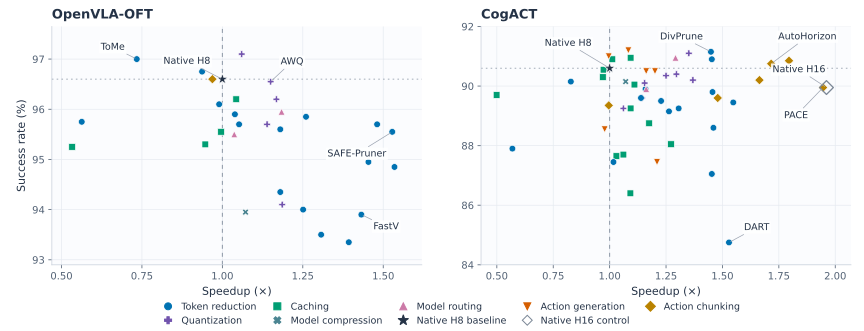

# Efficient-VLA-Benchmark

[](https://arxiv.org/pdf/2510.17111)
[](https://github.com/guanweifan/efficient-vla-benchmark/commits/main/)
[](https://github.com/guanweifan/efficient-vla-benchmark/pulls)
[](https://github.com/guanweifan/awesome-efficient-vla)



📖 The experimental companion to our **[Efficient VLA survey](https://arxiv.org/pdf/2510.17111)**
and **[paper list](https://github.com/guanweifan/awesome-efficient-vla)**.
Benchmark acceleration methods on **OpenVLA-OFT** and **CogACT** through configurable
algorithms, modular backends and shared LIBERO evaluation.

<p align="left">
  <a href="#quick-start">Quick Start</a> ·
  <a href="#supported-methods">Methods</a> ·
  <a href="#benchmarking">Benchmarking</a> ·
  <a href="#development">Development</a>
</p>

## Quick Start


Install OpenVLA-OFT below, or follow the [CogACT guide](backends/cogact/INSTALL.md)
in a separate environment.

### 1. Install

```bash
git clone https://github.com/guanweifan/efficient-vla-benchmark.git
cd efficient-vla-benchmark
git submodule update --init --recursive -- \
  backends/openvla_oft/upstream third_party/runtimes/transformers_openvla_oft \
  third_party/runtimes/dlimp third_party/benchmarks/libero
```

Set these variables to your own paths:

| Variable | Value |
|:---|:---|
| `ENV_DIR` | New Python environment directory |
| `FLASH_ATTN_WHEEL` | Compatible FlashAttention 2.5.5 wheel; see the [installation recipe](backends/openvla_oft/INSTALL.md) |
| `MODEL_DIR` | Checkpoint directory |
| `RUN_DIR` | Evaluation output directory |

```bash
python3.10 scripts/create_environment.py --backend openvla_oft \
  --venv "$ENV_DIR" --flash-attn-wheel "$FLASH_ATTN_WHEEL"
source "$ENV_DIR/bin/activate"

hf download moojink/openvla-7b-oft-finetuned-libero-spatial-object-goal-10 \
  --revision 638918f3d1c2e43a39a8a20772bdb8b91835e4b7 \
  --exclude 'lora_adapter/*' --local-dir "$MODEL_DIR"
```

### 2. Run the baseline

```bash
evb check-model --config configs/experiments/openvla_oft/baseline.yaml \
  --model-path "$MODEL_DIR"

evb evaluate --config configs/experiments/openvla_oft/baseline.yaml \
  --model-path "$MODEL_DIR" --libero-root third_party/benchmarks/libero \
  --output-dir "$RUN_DIR/baseline" --record-traces
```

Runs **four smoke episodes**, one per suite. No demonstration dataset is required.

### 3. Switch methods

```bash
evb evaluate --config configs/experiments/openvla_oft/fastv.yaml \
  --model-path "$MODEL_DIR" --libero-root third_party/benchmarks/libero \
  --output-dir "$RUN_DIR/fastv" --record-traces
```

Use `evb list` for compatibility and `evb validate-config --config "$PRESET"` to
check settings. Each run uses one method. Calibrated methods need `--artifact-path`;
external engines need `--runtime-path`.

**Assets:** the exact [CogACT LIBERO checkpoint](backends/cogact/README.md#model-asset)
is not yet public. Check [artifact requirements](docs/development.md#external-assets)
before running methods that need offline preparation.

## Supported Methods

Method names link to scope and dependencies; **✓** links to the final config.
**—** = no provided binding; `None` = no offline artifact required.

<details>
<summary><strong>Token reduction</strong></summary>

| Method | OpenVLA-OFT | CogACT | Preparation |
|:---|:---:|:---:|:---|
| [A-MMR · Current-frame core](src/efficient_vla_benchmark/methods/token_reduction/a_mmr/README.md) | [✓](configs/experiments/openvla_oft/a_mmr_current_frame.yaml) | [✓](configs/experiments/cogact/a_mmr_current_frame.yaml) | None |
| [ASR · Deletion core](src/efficient_vla_benchmark/methods/token_reduction/actuation_slack_refresh/README.md) | [✓](configs/experiments/openvla_oft/actuation_slack_refresh_deletion.yaml) | [✓](configs/experiments/cogact/actuation_slack_refresh_deletion.yaml) | None |
| [ADP](src/efficient_vla_benchmark/methods/token_reduction/adp/README.md) | [✓](configs/experiments/openvla_oft/adp.yaml) | [✓](configs/experiments/cogact/adp.yaml) | None |
| [DART](src/efficient_vla_benchmark/methods/token_reduction/dart/README.md) | [✓](configs/experiments/openvla_oft/dart.yaml) | [✓](configs/experiments/cogact/dart.yaml) | None |
| [DepthCache · Primary-view core](src/efficient_vla_benchmark/methods/token_reduction/depth_cache/README.md) | [✓](configs/experiments/openvla_oft/depth_cache_primary.yaml) | [✓](configs/experiments/cogact/depth_cache_primary.yaml) | Aligned depth |
| [DivPrune](src/efficient_vla_benchmark/methods/token_reduction/divprune/README.md) | [✓](configs/experiments/openvla_oft/divprune.yaml) | [✓](configs/experiments/cogact/divprune.yaml) | None |
| [EfficientVLA · Token core](src/efficient_vla_benchmark/methods/token_reduction/efficient_vla/README.md) | [✓](configs/experiments/openvla_oft/efficient_vla_token.yaml) | — | None |
| [ETA-VLA · ILSA core](src/efficient_vla_benchmark/methods/token_reduction/eta_vla/README.md) | [✓](configs/experiments/openvla_oft/eta_vla_ilsa.yaml) | [✓](configs/experiments/cogact/eta_vla_ilsa.yaml) | None |
| [FastV](src/efficient_vla_benchmark/methods/token_reduction/fastv/README.md) | [✓](configs/experiments/openvla_oft/fastv.yaml) | [✓](configs/experiments/cogact/fastv.yaml) | None |
| [FlashVLA · ICS only](src/efficient_vla_benchmark/methods/token_reduction/flash_vla/README.md) | [✓](configs/experiments/openvla_oft/flash_vla.yaml) | [✓](configs/experiments/cogact/flash_vla.yaml) | None |
| [SAFE-Pruner](src/efficient_vla_benchmark/methods/token_reduction/safe_pruner/README.md) | [✓](configs/experiments/openvla_oft/safe_pruner.yaml) | [✓](configs/experiments/cogact/safe_pruner.yaml) | None |
| [SparseVLM+ · V2](src/efficient_vla_benchmark/methods/token_reduction/sparsevlm/README.md) | [✓](configs/experiments/openvla_oft/sparsevlm.yaml) | [✓](configs/experiments/cogact/sparsevlm.yaml) | None |
| [SpecPrune-VLA · Native-head adaptation](src/efficient_vla_benchmark/methods/token_reduction/specprune_vla/README.md) | [✓](configs/experiments/openvla_oft/specprune_vla.yaml) | [✓](configs/experiments/cogact/specprune_vla.yaml) | None |
| [TIES](src/efficient_vla_benchmark/methods/token_reduction/ties/README.md) | [✓](configs/experiments/openvla_oft/ties.yaml) | [✓](configs/experiments/cogact/ties.yaml) | Calibration |
| [ToMe](src/efficient_vla_benchmark/methods/token_reduction/tome/README.md) | [✓](configs/experiments/openvla_oft/tome.yaml) | [✓](configs/experiments/cogact/tome.yaml) | None |
| [VisionZip](src/efficient_vla_benchmark/methods/token_reduction/visionzip/README.md) | [✓](configs/experiments/openvla_oft/visionzip.yaml) | [✓](configs/experiments/cogact/visionzip.yaml) | None |
| [VLA-Pruner](src/efficient_vla_benchmark/methods/token_reduction/vla_pruner/README.md) | [✓](configs/experiments/openvla_oft/vla_pruner.yaml) | — | None |

</details>

<details>
<summary><strong>Caching</strong></summary>

| Method | OpenVLA-OFT | CogACT | Preparation |
|:---|:---:|:---:|:---|
| [ActionCache](src/efficient_vla_benchmark/methods/caching/action_cache/README.md) | — | [✓](configs/experiments/cogact/action_cache.yaml) | Frozen trajectory cache |
| [ASR · KV-reuse core](src/efficient_vla_benchmark/methods/token_reduction/actuation_slack_refresh/README.md) | [✓](configs/experiments/openvla_oft/actuation_slack_refresh_kv_reuse.yaml) | [✓](configs/experiments/cogact/actuation_slack_refresh_kv_reuse.yaml) | None |
| [BAC](src/efficient_vla_benchmark/methods/caching/bac/README.md) | — | [✓](configs/experiments/cogact/bac.yaml) | Calibration |
| [C³ache · Conditioned-residual core](src/efficient_vla_benchmark/methods/caching/c3ache/README.md) | — | [✓](configs/experiments/cogact/c3ache_conditioned_residual.yaml) | None |
| [DP-Cache · Denoiser-reuse core](src/efficient_vla_benchmark/methods/caching/dp_cache/README.md) | — | [✓](configs/experiments/cogact/dp_cache.yaml) | None |
| [EfficientVLA · DiT-cache core](src/efficient_vla_benchmark/methods/token_reduction/efficient_vla/README.md) | — | [✓](configs/experiments/cogact/efficient_vla_cache.yaml) | None |
| [EVO](src/efficient_vla_benchmark/methods/caching/evo/README.md) | — | [✓](configs/experiments/cogact/evo.yaml) | Frozen searched layout† |
| [TeaCache](src/efficient_vla_benchmark/methods/caching/teacache/README.md) | — | [✓](configs/experiments/cogact/teacache.yaml) | Calibration |
| [Temporal Redundancy · Visual core](src/efficient_vla_benchmark/methods/caching/temporal_redundancy/README.md) | [✓](configs/experiments/openvla_oft/temporal_redundancy_visual.yaml) | [✓](configs/experiments/cogact/temporal_redundancy_visual.yaml) | None |
| [V-AEFusion](src/efficient_vla_benchmark/methods/caching/v_aefusion/README.md) | — | [✓](configs/experiments/cogact/v_aefusion.yaml) | None |
| [VLA-Cache](src/efficient_vla_benchmark/methods/caching/vla_cache/README.md) | [✓](configs/experiments/openvla_oft/vla_cache.yaml) | [✓](configs/experiments/cogact/vla_cache.yaml) | None |
| [VLA-InfoEntropy](src/efficient_vla_benchmark/methods/caching/vla_infoentropy/README.md) | [✓](configs/experiments/openvla_oft/vla_infoentropy.yaml) | [✓](configs/experiments/cogact/vla_infoentropy.yaml) | None |

</details>

<details>
<summary><strong>Model routing</strong></summary>

| Method | OpenVLA-OFT | CogACT | Preparation |
|:---|:---:|:---:|:---|
| [EcoVLA · Channel/head core](src/efficient_vla_benchmark/methods/model_routing/eco_vla/README.md) | [✓](configs/experiments/openvla_oft/eco_vla.yaml) | [✓](configs/experiments/cogact/eco_vla.yaml) | Calibration |
| [SP-VLA · Pruning + scheduling](src/efficient_vla_benchmark/methods/model_routing/sp_vla/README.md) | [✓](configs/experiments/openvla_oft/sp_vla.yaml) | [✓](configs/experiments/cogact/sp_vla.yaml) | None |

</details>

<details>
<summary><strong>Action generation</strong></summary>

| Method | OpenVLA-OFT | CogACT | Preparation |
|:---|:---:|:---:|:---|
| [DEIS](src/efficient_vla_benchmark/methods/action_generation/deis/README.md) | — | [✓](configs/experiments/cogact/deis.yaml) | Sampler dependency |
| [DPM-Solver++](src/efficient_vla_benchmark/methods/action_generation/dpm_solver_pp/README.md) | — | [✓](configs/experiments/cogact/dpm_solver_pp.yaml) | Sampler dependency |
| [Falcon](src/efficient_vla_benchmark/methods/action_generation/falcon/README.md) | — | [✓](configs/experiments/cogact/falcon.yaml) | None |
| [KeyStone](src/efficient_vla_benchmark/methods/action_generation/keystone/README.md) | — | [✓](configs/experiments/cogact/keystone.yaml) | None |
| [ProbeFlow · DDIM-coordinate port](src/efficient_vla_benchmark/methods/action_generation/probeflow/README.md) | — | [✓](configs/experiments/cogact/probeflow.yaml) | None |
| [UniPC](src/efficient_vla_benchmark/methods/action_generation/unipc/README.md) | — | [✓](configs/experiments/cogact/unipc.yaml) | Sampler dependency |

</details>

<details>
<summary><strong>Action chunking</strong></summary>

| Method | OpenVLA-OFT | CogACT | Preparation |
|:---|:---:|:---:|:---|
| [A³ · Official code](src/efficient_vla_benchmark/methods/action_chunking/a3_official/README.md) | — | [✓](configs/experiments/cogact/a3_official.yaml) | None |
| [AAC](src/efficient_vla_benchmark/methods/action_chunking/aac/README.md) | — | [✓](configs/experiments/cogact/aac.yaml) | None |
| [AutoHorizon](src/efficient_vla_benchmark/methods/action_chunking/autohorizon/README.md) | — | [✓](configs/experiments/cogact/autohorizon.yaml) | None |
| [DVAC](src/efficient_vla_benchmark/methods/action_chunking/dvac/README.md) | — | [✓](configs/experiments/cogact/dvac.yaml) | None |
| [PACE](src/efficient_vla_benchmark/methods/action_chunking/pace/README.md) | [✓](configs/experiments/openvla_oft/pace.yaml) | [✓](configs/experiments/cogact/pace.yaml) | Demonstration calibration |
| [VOTE · H8 overlap adaptation](src/efficient_vla_benchmark/methods/action_chunking/vote_ensemble/README.md) | — | [✓](configs/experiments/cogact/vote_ensemble.yaml) | None |

</details>

<details>
<summary><strong>Quantization</strong></summary>

| Method | OpenVLA-OFT | CogACT | Preparation |
|:---|:---:|:---:|:---|
| [ActQuant](src/efficient_vla_benchmark/methods/quantization/actquant/README.md) | [✓](configs/experiments/openvla_oft/actquant.yaml) | — | Calibrated GGUF + runtime† |
| [AWQ](src/efficient_vla_benchmark/methods/quantization/awq/README.md) | [✓](configs/experiments/openvla_oft/awq.yaml) | [✓](configs/experiments/cogact/awq.yaml) | Calibration + kernels |
| [DA-PTQ · DA-MPA core](src/efficient_vla_benchmark/methods/quantization/da_mpa/README.md) | — | [✓](configs/experiments/cogact/da_mpa.yaml) | Calibration + kernels |
| [DyQ-VLA · V2 temporal core](src/efficient_vla_benchmark/methods/quantization/dyq_vla/README.md) | [✓](configs/experiments/openvla_oft/dyq_vla.yaml) | [✓](configs/experiments/cogact/dyq_vla.yaml) | Trajectory calibration + runtime† |
| [GPTQ](src/efficient_vla_benchmark/methods/quantization/gptq/README.md) | [✓](configs/experiments/openvla_oft/gptq.yaml) | [✓](configs/experiments/cogact/gptq.yaml) | Calibration + kernels |
| [HoloQ · Official-code variant](src/efficient_vla_benchmark/methods/quantization/holoq/README.md) | — | [✓](configs/experiments/cogact/holoq.yaml) | Calibration + kernels |
| [QuantVLA](src/efficient_vla_benchmark/methods/quantization/quantvla/README.md) | — | [✓](configs/experiments/cogact/quantvla.yaml) | Calibration + kernels |
| [SmoothQuant](src/efficient_vla_benchmark/methods/quantization/smoothquant/README.md) | [✓](configs/experiments/openvla_oft/smoothquant.yaml) | [✓](configs/experiments/cogact/smoothquant.yaml) | Calibration + kernels |

</details>

<details>
<summary><strong>Model compression</strong></summary>

| Method | OpenVLA-OFT | CogACT | Preparation |
|:---|:---:|:---:|:---|
| [EfficientVLA · Layer-pruning core](src/efficient_vla_benchmark/methods/token_reduction/efficient_vla/README.md) | [✓](configs/experiments/openvla_oft/efficient_vla_layer.yaml) | [✓](configs/experiments/cogact/efficient_vla_layer.yaml) | Calibration |

</details>

† See [artifact availability](docs/development.md#external-assets).
These are common-checkpoint adaptations; partial cores are labeled explicitly.

[Action tokenizer / codec evaluation](src/efficient_vla_benchmark/action_codecs/README.md)
uses a separate environment and reconstruction benchmark.

## Benchmarking

Success is measured over **2,000 LIBERO episodes** per configuration. Speedup measures
full policy/control cost on **RTX 3090**, against a matched native reference on the
same GPU; simulation time is excluded.

| Task | Start here |
|:---|:---|
| Compare methods | [Success, latency and memory](docs/benchmark_results.md) · [Selected configurations](configs/evaluation/primary_selection.yaml) |
| Measure success | [Fixed episode sets and parallel evaluation](docs/development.md#fixed-development-validation) |
| Measure latency | [Replay inputs and timing commands](docs/development.md#rebuilding-evaluation-inputs) · [Timing protocol](docs/development.md#calibration-evaluation-and-timing) |

## Development

```text
backends/<backend>/               Optional plugin + pinned native source
src/efficient_vla_benchmark/
  core/                           Contracts, config and discovery
  methods/<category>/<method>/    One method, explicit backend bindings
  model_ops/                      Shared tensor operations
  control/                        Action queue and scheduling
  evaluation/                     Shared LIBERO harness
  profiling/                      Replay timing and accounting
  action_codecs/                  Independent reconstruction benchmark
configs/                          Final presets and reusable defaults
third_party/                      Pinned references, runtimes and simulator
tests/ · templates/ · scripts/    Checks, extension examples and tools
docs/                             Development guide and result ledger
```

See the [development guide](docs/development.md), [method template](templates/method/README.md)
and [backend template](templates/backend/README.md). [AGENTS.md](AGENTS.md) defines
contribution and Git rules. Regenerate the chart with the
[figure script](scripts/plot_benchmark_results.py) (requires Matplotlib).

## Citation

If you find this benchmark useful, please cite our survey:

```bibtex
@misc{guan2025efficientvisionlanguageactionmodelsembodied,
  title         = {Efficient Vision-Language-Action Models for Embodied Manipulation: A Systematic Survey},
  author        = {Weifan Guan and Qinghao Hu and Aosheng Li and Jian Cheng},
  year          = {2025},
  eprint        = {2510.17111},
  archivePrefix = {arXiv},
  primaryClass  = {cs.RO},
  url           = {https://arxiv.org/abs/2510.17111}
}
```

## License

First-party contributions use [MIT](LICENSE); third-party terms remain in [NOTICE](NOTICE).
The pinned dlimp and SpecPrune-VLA sources need license clarification before redistribution.
